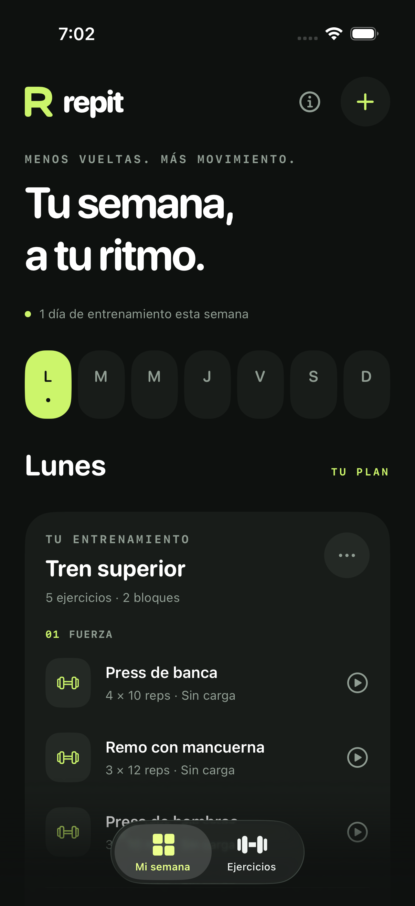
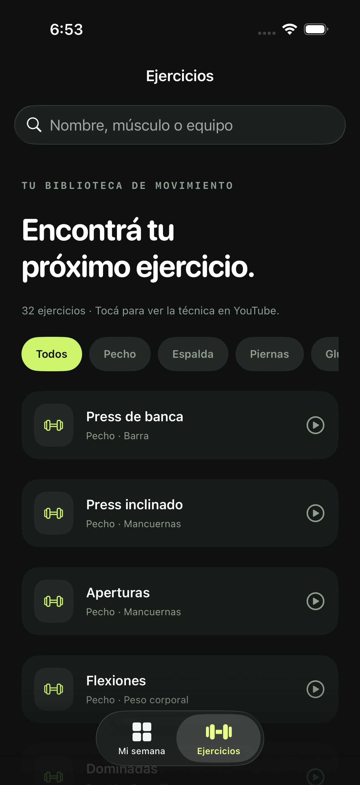
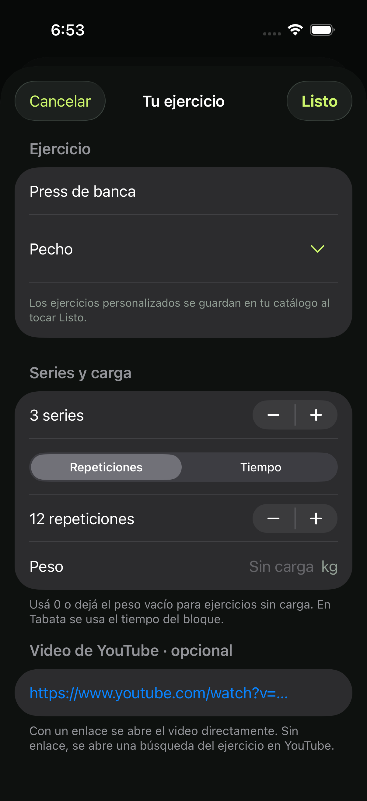
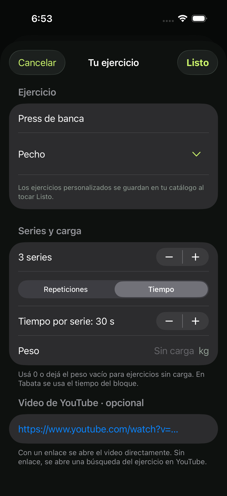

# repit


A native gym routine app with a **Spanish interface**, built with SwiftUI for **iOS 27+**. Designed for iPhone in portrait orientation and reviewed at iPhone 16 Pro dimensions. No account, server, or external dependencies required.

## Screenshots

Captured from the running app in an iPhone 16 Pro simulator with iOS 26.5.

| Weekly planner | Exercise library |
| --- | --- |
|  |  |
| Repetitions per set | Time per set |
|  |  |

## License and credits

Copyright © 2026 **gsanz.dev**. GNU GPL version 3 only (GPL-3.0-only), with the
notice-preservation term in [ATTRIBUTION.md](ATTRIBUTION.md). The full license
is in [LICENSE](LICENSE); [LICENSING.md](LICENSING.md) describes the project's
licensing and credits, following the same approach as IsoBuild.

The information button beside the create-routine button opens **About repit**.
It displays the original copyright notice, permissions and warranty notice,
the full GPLv3 text, and the attribution condition. These legal texts are
bundled and available offline. The interface remains in Spanish.

Every build automatically generates and bundles `Repit-Source.zip`, containing
the corresponding source, tests, resources, Xcode project, scripts, and build
instructions. It can be saved or shared from the About screen. Distributed
modified versions must include their own updated corresponding source and
preserve applicable notices. User-created routines are not subject to GPL
merely because they were created with this app.

After adding, removing, or renaming source files, refresh the build script's
sandbox input list before building:

```sh
python3 scripts/package-source.py --write-input-list
```

## Build and run

1. Open `Repit.xcodeproj` in Xcode 27 or later.
2. Select the **Repit** scheme and an iPhone running iOS 27, or a simulator with that runtime.
3. To install on your iPhone, select your team under **Signing & Capabilities → Team**. Change the bundle identifier if your account requires it.
4. Run with **⌘R**.

```sh
xcodebuild -project Repit.xcodeproj -scheme Repit \
  -destination 'generic/platform=iOS Simulator' \
  -derivedDataPath /tmp/repit-build CODE_SIGNING_ALLOWED=NO build
```

## Features

- Weekly planning with multiple routines per day.
- Create, edit, duplicate, reschedule, and delete routines.
- Strength, circuit, and Tabata blocks, with reordering for blocks and exercises.
- A shared local catalog of 32 built-in exercises plus saved custom exercises, with case- and accent-insensitive search and muscle group filters.
- Custom exercises are saved to the library when **Done** is selected in the exercise editor, independently of saving the routine. They remain reusable after restarting the app.
- Matching muscle groups are merged regardless of case, accents, or extra whitespace. Existing groups accept their Spanish display names or English source names; new groups become additional filters. Matching exercise names update a custom template rather than creating duplicates, and built-in exercises are not duplicated.
- Sets, a **Repetitions / Time** selector, and optional weight in kg. Time is a target duration per set, in seconds; it replaces the repetition target in routine summaries and the workout screen. Switching modes preserves both values. Both decimal commas and decimal points are accepted for weight.
- Optional YouTube and Shorts links. Without a video link, tapping an exercise opens a **YouTube search**, rather than an automatically selected video.
- A workout session screen for checking off sets. Circuits repeat every exercise's sets and repetitions in each round.
- A configurable Tabata timer with work and rest intervals. Each interval uses one exercise, cycling through the block in order. The total duration includes the final interval's rest.
- Automatic timer pause when leaving the app, and confirmation before discarding edits or leaving a session.
- Atomic local storage in `Documents/repit-routines.json` and `Documents/repit-exercises.json`. If loading fails, the affected original file is preserved and its writes are blocked to prevent overwriting damaged data.

The first launch starts empty. A sample routine can be loaded for any weekday; weights remain unset so each person can choose their own loads. For demo screenshots, the `--demo` launch argument loads the Monday sample only when no routines exist.

Workout progress lasts for the open session. This version does not store session history, sync across devices, or provide a remote catalog. Videos require an internet connection; everything else works offline.

## Language conventions

Source code, identifiers, filenames, comments, test fixtures, and documentation use English. The app's interface remains in Spanish, including exercise names, accessibility labels, and error messages.

- `Repit/Resources/es.lproj/Localizable.strings` contains Spanish translations keyed by English source text.
- `Repit/Models/Localization.swift` resolves those keys and formats dynamic messages using the Spanish locale.
- The root SwiftUI view explicitly uses the Spanish locale for system-provided controls.
- User-entered names remain unchanged.
- New saves use English block type identifiers (`standard`, `circuit`, and `tabata`). The decoder also accepts the original Spanish values so existing routines stay readable.
- Older exercises without measurement fields load in repetitions mode. Custom templates retain their sets, repetition/time target, weight, and optional video link; each insertion into a routine receives a fresh identifier.

## Validation

The initial version passed iOS 27 device and simulator builds, model checks, and an end-to-end UI test on an iPhone 16 Pro simulator running iOS 26.5. The interface screenshot is at `screenshots/my-week.png`.

```sh
./scripts/test-models.sh
```

Model checks cover persistence after restart, edits and deletion, corrupted-file protection, failed writes, catalog filters, video URLs, interval boundaries, circuit totals, Spanish resource loading, and compatibility with previously saved block types. They also cover custom library persistence, duplicate prevention, category matching, reusable timed templates, and older exercises without measurement fields.

The **RepitUITests** target creates a routine with catalog and manual exercises, enters a decimal weight, checks persistence after relaunch, marks a set, and edits the routine. UI controls are located using English accessibility identifiers, independently of their Spanish labels.

It also verifies the credits entry, the original copyright notice, offline
GPLv3 and attribution texts, and the presence of the bundled source archive.

`ExerciseLibraryUITests` verifies creation, category assignment, persistence,
and reuse of a timed custom exercise. Its screenshot test captures the four
screens shown above and checks that the measurement control switches in both
directions. The exported PNGs are stored under `screenshots/`.

```sh
xcodebuild -project Repit.xcodeproj -scheme Repit \
  -destination 'platform=iOS Simulator,name=iPhone 16 Pro' test
```

The initial development environment has the iOS 27 SDK, but its newest installed simulator runtime is iOS 26.5. Interface validation uses a command-line-only `IPHONEOS_DEPLOYMENT_TARGET=26.5` override. The project's minimum deployment target remains **27.0**. Execution on iOS 27 and a physical device still requires the corresponding runtime or device and code signing.

## Brand assets

The rounded **R** symbol uses the app's lime accent on a dark background. The
app icon, interface mark, and editable SVG share the same vector geometry in
`Repit/Models/BrandMark.swift`. The iOS icon is an opaque 1024 × 1024 PNG;
iOS applies its corner mask. The transparent vector symbol is available at
[`Repit/Resources/Brand/RepitSymbol.svg`](Repit/Resources/Brand/RepitSymbol.svg).

Regenerate both assets on macOS:

```sh
xcrun swiftc Repit/Models/BrandMark.swift scripts/generate-icon.swift \
  -o /tmp/repit-generate-icon
/tmp/repit-generate-icon \
  Repit/Resources/Assets.xcassets/AppIcon.appiconset/AppIcon.png \
  Repit/Resources/Brand/RepitSymbol.svg
```

## Project structure

- `Repit/Models/Workout.swift`: routines, blocks, exercises, catalog, and interval calculations.
- `Repit/Models/RoutineStore.swift`: persistence and read/write errors.
- `Repit/Models/ExerciseLibraryStore.swift`: persistent custom exercise templates, category normalization, and combined catalog search.
- `Repit/Models/Localization.swift`: Spanish string lookup and formatting.
- `Repit/Resources/es.lproj/Localizable.strings`: Spanish interface copy with English keys.
- `Repit/Views/ContentView.swift`: weekly planner and exercise library.
- `Repit/Views/AboutView.swift`: credits, offline legal texts, and source sharing.
- `Repit/Views/RoutineEditor.swift`: draft-based editing; saving commits changes.
- `Repit/Views/SessionView.swift`: workout session and timer.
- `Repit/Views/Theme.swift`: shared components and colors.
- `Repit/Models/BrandMark.swift`: shared vector paths for the brand symbol.
- `scripts/generate-icon.swift`: reproducible Core Graphics rendering and SVG export.
- `scripts/package-source.py`: corresponding source archive generated for every build.
- `LICENSE`, `ATTRIBUTION.md`, and `LICENSING.md`: license text, attribution condition, and licensing documentation.

Bundled external video links: [Air squat](https://www.youtube.com/watch?v=jQyKVKjucNU) and [Dumbbell shoulder press](https://www.youtube.com/watch?v=qEwKCR5JCog). No video files are distributed.
